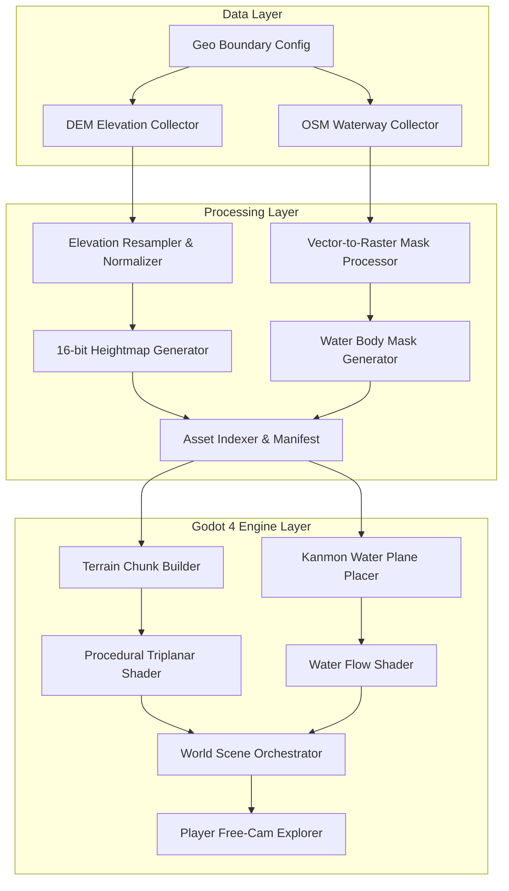

# [260917] 간몬 해협 가상 지형 자동화 렌더링 초기 사업 계획서

- 작성일자: 2026년 09월 17일
- 작성자: Antigravity AI

---

## 1. 개요 및 목적
본 계획서는 일본 야마구치현 시모노세키 항부터 후쿠오카현 기타큐슈(고쿠라)에 이르는 간몬 해협(Kanmon Straits) 일대의 자연 지형을 100% 무인 자동화 파이프라인을 통해 가상 3D 공간으로 구축하고, Godot 4 엔진 환경에서 실시간 렌더링 및 탐색이 가능하도록 구현하기 위한 초기 기술 규격 및 아키텍처 계획서입니다.

---

## 2. 지리적 경계 및 공간 스펙
- 대상 지역: 일본 시모노세키-고쿠라 간몬 해협권역
- 중심 좌표: 위도 33.95° N, 경도 130.93° E
- 바운딩 박스 (BBox):
  - North: 34.0200° N (시모노세키 북부 산악지)
  - South: 33.8500° N (고쿠라/기타큐슈 남부 구릉지)
  - West: 130.8500° E (히비키나다 연안)
  - East: 131.0500° E (세토내해 진입부)
- 실세계 면적: 약 18.5 km × 18.8 km (약 348 km²)
- 핵심 자연 지표:
  - 히노야마(火の山, 시모노세키 측 산악 지형)
  - 아다치산(足立山, 고쿠라 측 산악 지형)
  - 간몬 해협 본류(강한 조류와 좁은 수로 형태의 바다)

---

## 3. 시스템 아키텍처 및 모듈 분할

### 3.1. 모듈별 역할 및 책임
- `pipeline/collectors/`: 외부 API(AWS Open Data, OpenStreetMap Overpass) 비동기 수집 모듈. 네트워크 오류 복구 및 타일 캐싱 담당.
- `pipeline/processors/`: 지리 좌표 투영계(WGS84 -> UTM 또는 정규 그리드) 변환, 16-bit 그레이스케일 높이맵 추출, 해안선 마스킹.
- `pipeline/indexer/`: 모든 생성 자산의 메타데이터(크기, 축척, 해상도, 생성일자, 체크섬)를 `manifest.json`으로 인덱싱.
- `godot_project/scripts/terrain/`: 하이트맵을 읽어 버텍스 메시와 콜라이더를 청크 단위로 구성하는 런타임 클래스.
- `godot_project/shaders/`: 고도, 경사도, 해안선 마스크에 따라 텍스처를 절차적으로 합성하는 셰이더.
- `godot_project/scripts/player/`: 지형 및 해협 상공을 원활히 탐색하는 6자유도 컨트롤러.

---

## 4. 데이터 규격 및 인터페이스
- **높이맵 포맷:** 16-bit Grayscale PNG (동적 범위: 해발 -50m ~ +600m)
- **해상도 단위:** 1픽셀 당 약 10m~15m 지상 해상도 (초기 프로토타입 2048×2048 픽셀)
- **수계 마스크:** 8-bit Grayscale PNG (0: 육지, 255: 해협/하천 수면)
- **자산 매니페스트:** JSON 스키마 기반 메타데이터 기록 (자산 경로, 바운딩 박스, 해상도, 해수면 기준 Y값)

---

## 5. 단계별 검증 및 성공 기준
- [ ] 1차 검증: 스크립트 1회 실행으로 시모노세키-고쿠라 높이맵 및 수면 마스크 정상 수집 및 생성.
- [ ] 2차 검증: Godot 4 엔진에서 생성된 높이맵을 로드하여 히노야마 및 아다치산의 능선 형상이 실제 지형과 일치함을 확인.
- [ ] 3차 검증: 간몬 해협 수면이 해발 0m 기준에서 정확히 육지와 분리되어 렌더링되는지 확인.
- [ ] 4차 검증: 플레이어 카메라로 시모노세키항에서 해협을 건너 고쿠라 방면으로 60 FPS 이상으로 이동 가능한지 확인.
