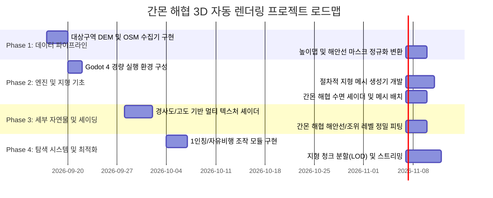

# [260917] 간몬 해협 가상 지형 자동화 렌더링 프로젝트 로드맵

- 작성일자: 2026년 09월 17일
- 작성자: Antigravity AI

---

## 1. 프로젝트 비전 및 궁극 목표
- 현실의 지리/공간 데이터(DEM 고도, OSM 수계/해안선)를 기반으로 사람의 개입 없이 100% 무인 자동 파이프라인을 거쳐 3D 가상 지형을 생성.
- 대상 구역: 일본 시모노세키 항 및 간몬 해협을 거쳐 고쿠라(기타큐슈)에 이르는 자연 지형(산, 바다, 해협, 하천).
- Godot 4 엔진 기반으로 대규모 지형을 경량·모듈형 구조로 렌더링하고 사용자가 자유롭게 탐색할 수 있는 가상 환경 구축.

---

## 2. 모듈화 및 개발 원칙
- **철저한 단일 책임 원칙 (SRP):** 데이터 수집, 데이터 변환, 3D 지형 빌더, 셰이더 매니저, 캐릭터 컨트롤러를 완전 분리.
- **코드 경량화 제한 준수:** 모든 단일 소스 코드 파일은 800라인 이하를 엄격히 준수. 초과 시 즉시 서브모듈로 분할.
- **인덱싱 및 자동 추적:** 생성되는 모든 자산 및 모듈에 고유 인덱스(`asset_manifest.json`, `module_index.json`) 부여.
- **무인 자동화 보장:** 위경도 Bounding Box 입력 시 데이터 다운로드부터 3D 씬 배치까지 단일 실행 커맨드로 완결.

---

## 3. 단계별 마일스톤 (Milestones)

### Phase 1: 데이터 파이프라인 자동화 (Data Pipeline)
- [ ] 시모노세키-고쿠라 Bounding Box 설정 모듈 (`config/geo_boundary.json`)
- [ ] AWS Open Data / Terrarium 고도 데이터 타일 무인 다운로더 (`pipeline/collectors/dem_fetcher.py`)
- [ ] Overpass API 기반 간몬 해협 해안선 및 하천 벡터 수집기 (`pipeline/collectors/osm_fetcher.py`)
- [ ] 16-bit 정밀 높이맵 및 워터마스크 이미지 합성 엔진 (`pipeline/processors/heightmap_builder.py`)
- [ ] 자산 생성 인덱스 생성기 (`pipeline/indexer/asset_indexer.py`)

### Phase 2: Godot 4 렌더링 코어 (Rendering Core)
- [ ] Godot 4 경량 런타임 환경 구성
- [ ] 높이맵 기반 동적 `ArrayMesh` / 청크 단위 지형 빌더 (`godot_project/scripts/terrain/mesh_builder.gd`)
- [ ] 해협 해수면(Sea Level) 평면 메시 및 유체 셰이더 (`godot_project/shaders/kanmon_water.gdshader`)
- [ ] 물리 충돌체(`HeightMapShape3D`) 절차적 연결

### Phase 3: 지형 디테일 및 바이옴 매핑 (Detail & Shading)
- [ ] 고도 및 경사각 기반 절차적 지형 셰이더 (`godot_project/shaders/procedural_terrain.gdshader`)
- [ ] 간몬 해협 해안선 경계 블렌딩 (젖은 모래/암석)
- [ ] 파이프라인 자동 실행 래퍼 스크립트 작성

### Phase 4: 플레이어 탐색 및 런타임 최적화 (Exploration & Optimization)
- [ ] 자유 비행 카메라 및 1인칭 보행자 컨트롤러 (`godot_project/scripts/player/player_controller.gd`)
- [ ] 대규모 지형 청크 기반 비동기 로딩 및 LOD 최적화
- [ ] 전체 빌드 검증 및 자산 무결성 테스트
